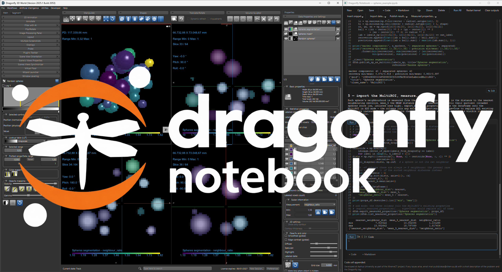
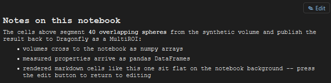
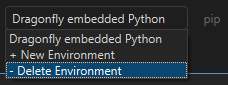

# Dragonfly Notebook

A Jupyter-style notebook for [Dragonfly](https://www.comet.eu/en/dragonfly):
run Python cells against your Dragonfly scene: import channels, ROIs and
MultiROIs as numpy arrays, publish results back as Dragonfly objects, and
read or write the measured properties of a segmentation. The notebook runs
in its own process with its own IPython kernel, so Dragonfly's GUI stays
fully responsive while cells execute, including the Stop button and live
output streaming.



## Highlights

* A private IPython kernel (lazy start, one click Restart). Dragonfly's
  console and scene are never touched by notebook variables.
* A two-way bridge through the `dfnb` namespace: import volumes/ROIs/
  MultiROIs as numpy arrays, publish arrays back as Channels/ROIs/MultiROIs,
  read and write measured properties, list the live scene objects.
* Optional private Python environments: select, create and delete them
  from the toolbar's top-right environment field, pip install into the
  selected one with its own pip, switch between it and the
  embedded Python; the choice is saved with the notebook.
* Toolbar snippet pickers: pick a Dragonfly object in a dialog and the exact
  `dfnb` call is inserted into the cell; every dialog follows Dragonfly's
  dark look.
* Plain `.ipynb` files (nbformat 4.x): open/save, code and markdown cells,
  inline matplotlib figures, pygments highlighting.
* Jupyter-style markdown cells: running one renders it in place, and a
  small edit button at its top-right flips it back to source.

  
* Drag a `.ipynb` from Windows Explorer onto the Dragonfly window (or onto
  an open notebook window) to open it.
* Mid-run control: a busy bar in the status strip, the running cell's Run
  button becomes a red Stop button, elapsed-time footers tick live.
* If Dragonfly closes, the notebook window shows a banner and reconnects
  automatically once Dragonfly is back.

## Requirements

* Dragonfly 2025.1 (Comet) on Windows. Nothing else: the plugin runs on
  Dragonfly's embedded Python interpreter.

## Install

1. Close Dragonfly.
2. From this folder, run:
   `powershell -ExecutionPolicy Bypass -File Install.ps1`
   (installs into every detected Dragonfly user-plugin root)
3. Start Dragonfly and open **Utilities > Plugins > Run Dragonfly Notebook**.

To uninstall: `powershell -ExecutionPolicy Bypass -File Install.ps1 -Uninstall`.

## The `dfnb` bridge: the eleven functions

`source` and `reference` accept an object's title, its GUID, or the handle
dict a publish call returned. `properties` is a pandas DataFrame (one column
per property, one row per label; a background row is padded automatically)
or a dict of `{name: values}`.

| Function | What it does |
|---|---|
| `list_objects(class_name='Channel', representable_only=True)` | The live scene objects of a class (`'Channel'`, `'ROI'`, `'MultiROI'`) |
| `import_volume_as_np(source, timestep=0)` | A channel's data as a fresh numpy array |
| `import_roi_as_np(source, timestep=0)` | Same, for a ROI |
| `import_multiroi_as_np(source, timestep=0)` | Same, for a MultiROI's label array |
| `import_measured_properties(source, properties=None, timestep=0)` | A MultiROI's measured properties as a DataFrame (`properties` selects/subsets columns) |
| `list_measured_properties(source, timestep=0)` | The property column names |
| `export_measured_properties(source, properties, timestep=0, wipe=False)` | Write properties onto an existing MultiROI: `wipe=False` adds them next to the existing ones, `wipe=True` replaces ALL its properties |
| `publish_np_as_volume(array, title=None, reference=None, spacing=None)` | Publish an array as a new Channel; returns a handle for later imports |
| `publish_np_as_roi(array, title=None, reference=None, spacing=None)` | Publish a 0/1 mask as a new ROI |
| `publish_np_as_multiroi(array, title=None, reference=None, spacing=None, properties=None)` | Publish a label array as a new MultiROI, optionally carrying measured properties |
| `delete_object(source)` | Delete one object from the session by title, GUID or handle; useful for removing a stale same-titled object before publishing a new one with the same title |

`timestep` selects the timepoint of a time-series object (0 for static
data). `reference` inherits geometry and spacing from an existing volume;
`spacing` sets them explicitly.

## The example notebook

[`examples/spheres_example.ipynb`](examples/spheres_example.ipynb) walks
through every interaction in five cells:

1. **Create + publish**: build a volume of 40 gradient spheres,
   rejection-sampled so overlaps stay shallow (each sphere a bright 2-px
   seed core fading to its edge); a `_clear` helper first deletes
   same-titled leftovers via `dfnb.delete_object`, so the notebook is
   re-runnable.
2. **Import**: read the published volume back from Dragonfly as a numpy
   array and verify it round-trips.
3. **Threshold + publish as ROI**: a low 0.05 cut (the background is
   exactly 0) keeps each sphere's full gradient footprint; touching
   spheres fuse into single blobs in the mask.
4. **Watershed + publish as MultiROI**: a marker-controlled watershed
   (`skimage.segmentation.watershed`) on the inverted intensity, confined
   to the mask: the spheres' bright 2-px seed cores are the markers, the
   floods meet at the necks between touching spheres, and all 40 spheres
   come out as their own full-size labels. The cell prints the
   ground-truth recovery check (each label recovers ≥ 85% of its sphere)
   and publishes them as a MultiROI.
5. **Measure + export properties**: import the MultiROI, compute each
   sphere's nearest-neighbour distance, mean distance to its five nearest
   neighbouring centroids and their ratio, and write them onto the MultiROI
   as measured properties (`export_measured_properties` in its default add
   mode; pass `wipe=True` to replace all existing properties).

Open the notebook by dropping it onto a notebook window (or via the
toolbar's Open button) and run it top to bottom with Dragonfly open.

## Custom Python environments

Each notebook can run on its own virtual environment instead of the
embedded Python, so packages Dragonfly's Python does not ship can be
pip installed and imported in cells. The notebook window and the
Dragonfly bridge always stay on the embedded Python; a notebook on a
custom environment runs its cells in a separate kernel process on that
environment's own Python and site-packages, so the two package sets
never mix inside one interpreter.

* Pick the environment in the toolbar's dropdown: click the environment
  field at the TOP RIGHT of the notebook toolbar, the field labeled
  'Dragonfly embedded Python' while the embedded interpreter is
  selected. The dropdown is where environments are selected, created
  ('+ New Environment') and deleted ('- Delete Environment'). The
  default is the Dragonfly embedded Python (what notebooks used
  before); the choice is saved with the notebook and restored on open.

  
* '+ New Environment' in the dropdown opens a name field. Creation takes
  about a minute and streams what is happening; a second streamed
  install then puts the base packages in: numpy and pandas, the minimum
  the notebook's data paths need (volumes cross as numpy arrays,
  measured properties as pandas DataFrames).
* The 'pip' button on the toolbar, active while a custom environment is
  selected and nothing else of the window is running (a cell run or an
  environment operation), is where pip runs: it is the only pip
  interface -- type the full command (`pip install
  yfinance`, `pip uninstall numpy`, `pip list`; a leading
  `python -m pip` is tolerated, `pip update x` runs as
  `pip install --upgrade x`, and an uninstall is confirmed
  automatically) and the environment's own pip runs it, streaming its
  output. A kernel left running on the environment does not lock the
  button: it holds its DLLs loaded, so a pip command that replaces
  them can fail with a Windows file-in-use error (the streamed dialog
  shows pip's diagnostic; restarting the kernel first is the clean
  path, and the button's tooltip carries the same note).
* In environment cells, `!command` lines run as shell escapes: a bare
  `python` means the environment's own interpreter. Pip does not run
  from cells -- `!pip`, `%pip`, and `python -m pip` lines are refused
  with a note pointing at the pip button -- and other `%` magics need
  the embedded kernel.
* '- Delete Environment' in the dropdown removes one environment from
  disk after a confirmation. If the notebook's own kernel is running
  on the environment, it is stopped first and the notebook switches
  back to the embedded Python; an environment another notebook
  window's kernel is using is refused (switch or close that window
  first).
* Switching the environment of a notebook whose kernel has run restarts
  the kernel (one confirmation): the namespace is wiped, the notebook and
  its cells are not touched.
* `dfnb` calls work unchanged in environment cells: they cross to the
  notebook application and on to Dragonfly, arrays included.
* Environments live under `%LOCALAPPDATA%\DragonflyNotebook\environments`:
  every environment is a full `python -m venv` tree under
  `%LOCALAPPDATA%\DragonflyNotebook\environments\<name>`, and
  '- Delete Environment' removes that whole tree from disk.
  They also carry the distribution's runtime DLLs (copied in on
  creation and at each kernel start, whatever the embedded distribution
  parks outside the base tree), so the standard library itself, sqlite3
  and tkinter included, imports inside them.

Switching back to the embedded Python is always available in the
dropdown.

## How it works

Each notebook window is a separate, ORS-free process launched by the plugin;
Dragonfly's plugin process hosts a small request/response server on a
QLocalSocket, and the notebook's `dfnb` namespace talks to it over that
pipe. Cells execute on a worker thread of the notebook process, so the
window keeps painting, streaming output and accepting the Stop click while
a cell runs; an interrupt is armed through a heartbeat that raises
`KeyboardInterrupt` in the kernel between Python lines. The same separation
is why `orsObj` and the console's variables are deliberately NOT visible in
cells; data crosses through `dfnb` only.

## Support

Developed at Aarhus University as part of the XtremeCT project, with AI
assistance from the lab-deep and lab-coder models of the Natural Sciences
AI Lab. If any issues arise, email marius.didziokas@chem.au.dk with a short
description of the problem and the Dragonfly log (found under
`%LOCALAPPDATA%\Comet\Dragonfly2025.1\logs`).

## Verifying a checkout (development)

Run the suites on Dragonfly's embedded interpreter via
[uv](https://docs.astral.sh/uv/), from the project root, one tier at a time:

```
uv run --no-project --python "C:\Program Files\Dragonfly\Python_env\python.exe" verification/test_dragonflynotebook_core.py
uv run --no-project --python "C:\Program Files\Dragonfly\Python_env\python.exe" verification/dfpy_ors.py verification/test_dragonflynotebook_datapath.py
uv run --no-project --python "C:\Program Files\Dragonfly\Python_env\python.exe" verification/dfpy_ors.py verification/_kernel_smoke_helper.py .
uv run --no-project --python "C:\Program Files\Dragonfly\Python_env\python.exe" verification/dfpy_ors.py verification/_stage_tier3.py
```

Tier 1 covers the ORS-free core, tier 2 the bridge data path, command 3 a
kernel smoke test on the project sources, and command 4 the full suite
against a staged copy of the plugin (your real installs are never touched).

## License

MIT; see [LICENSE](LICENSE).
