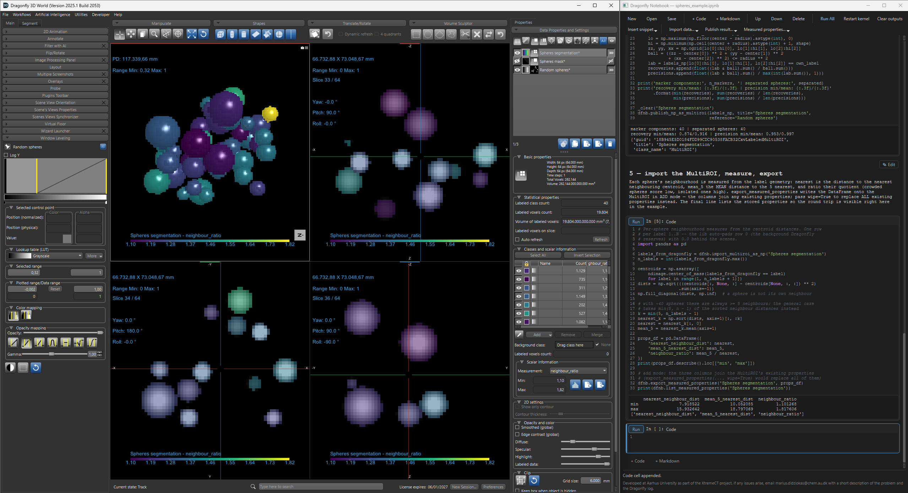

# Dragonfly Notebook

A Jupyter-style notebook for [Dragonfly](https://www.comet.eu/en/dragonfly):
run Python cells against your Dragonfly scene: import channels, ROIs and
MultiROIs as numpy arrays, publish results back as Dragonfly objects, and
read or write the measured properties of a segmentation. The notebook runs
in its own process with its own IPython kernel, so Dragonfly's GUI stays
fully responsive while cells execute, including the Stop button and live
output streaming.



## Highlights

* A private IPython kernel (lazy start, one click Restart). Dragonfly's
  console and scene are never touched by notebook variables.
* A two-way bridge through the `dfnb` namespace: import volumes/ROIs/
  MultiROIs as numpy arrays, publish arrays back as Channels/ROIs/MultiROIs,
  read and write measured properties, list the live scene objects.
* Toolbar snippet pickers: pick a Dragonfly object in a dialog and the exact
  `dfnb` call is inserted into the cell; every dialog follows Dragonfly's
  dark look.
* Plain `.ipynb` files (nbformat 4.x): open/save, code and markdown cells,
  inline matplotlib figures, pygments highlighting.
* Jupyter-style markdown cells: running one renders it in place, and a
  small edit button at its top-right flips it back to source.
* Drag a `.ipynb` from Windows Explorer onto the Dragonfly window (or onto
  an open notebook window) to open it.
* Mid-run control: a busy bar in the status strip, the running cell's Run
  button becomes a red Stop button, elapsed-time footers tick live.
* If Dragonfly closes, the notebook window shows a banner and reconnects
  automatically once Dragonfly is back.

## Requirements

* Dragonfly 2025.1 (Comet) on Windows. Nothing else: the plugin runs on
  Dragonfly's embedded Python interpreter.

## Install

1. Close Dragonfly.
2. From this folder, run:
   `powershell -ExecutionPolicy Bypass -File Install.ps1`
   (installs into every detected Dragonfly user-plugin root)
3. Start Dragonfly and open **Utilities > Plugins > Run Dragonfly Notebook**.

To uninstall: `powershell -ExecutionPolicy Bypass -File Install.ps1 -Uninstall`.

## The `dfnb` bridge: the eleven functions

`source` and `reference` accept an object's title, its GUID, or the handle
dict a publish call returned. `properties` is a pandas DataFrame (one column
per property, one row per label; a background row is padded automatically)
or a dict of `{name: values}`.

| Function | What it does |
|---|---|
| `list_objects(class_name='Channel', representable_only=True)` | The live scene objects of a class (`'Channel'`, `'ROI'`, `'MultiROI'`) |
| `import_volume_as_np(source, timestep=0)` | A channel's data as a fresh numpy array |
| `import_roi_as_np(source, timestep=0)` | Same, for a ROI |
| `import_multiroi_as_np(source, timestep=0)` | Same, for a MultiROI's label array |
| `import_measured_properties(source, properties=None, timestep=0)` | A MultiROI's measured properties as a DataFrame (`properties` selects/subsets columns) |
| `list_measured_properties(source, timestep=0)` | The property column names |
| `export_measured_properties(source, properties, timestep=0, wipe=False)` | Write properties onto an existing MultiROI: `wipe=False` adds them next to the existing ones, `wipe=True` replaces ALL its properties |
| `publish_np_as_volume(array, title=None, reference=None, spacing=None)` | Publish an array as a new Channel; returns a handle for later imports |
| `publish_np_as_roi(array, title=None, reference=None, spacing=None)` | Publish a 0/1 mask as a new ROI |
| `publish_np_as_multiroi(array, title=None, reference=None, spacing=None, properties=None)` | Publish a label array as a new MultiROI, optionally carrying measured properties |
| `delete_object(source)` | Delete one object from the session by title, GUID or handle; useful for removing a stale same-titled object before publishing a new one with the same title |

`timestep` selects the timepoint of a time-series object (0 for static
data). `reference` inherits geometry and spacing from an existing volume;
`spacing` sets them explicitly.

## The example notebook

[`examples/spheres_example.ipynb`](examples/spheres_example.ipynb) walks
through every interaction in five cells:

1. **Create + publish**: build a volume of 40 gradient spheres,
   rejection-sampled so overlaps stay shallow (each sphere a bright 2-px
   seed core fading to its edge); a `_clear` helper first deletes
   same-titled leftovers via `dfnb.delete_object`, so the notebook is
   re-runnable.
2. **Import**: read the published volume back from Dragonfly as a numpy
   array and verify it round-trips.
3. **Threshold + publish as ROI**: a low 0.05 cut (the background is
   exactly 0) keeps each sphere's full gradient footprint; touching
   spheres fuse into single blobs in the mask.
4. **Watershed + publish as MultiROI**: a marker-controlled watershed
   (`skimage.segmentation.watershed`) on the inverted intensity, confined
   to the mask: the spheres' bright 2-px seed cores are the markers, the
   floods meet at the necks between touching spheres, and all 40 spheres
   come out as their own full-size labels. The cell prints the
   ground-truth recovery check (each label recovers ≥ 85% of its sphere)
   and publishes them as a MultiROI.
5. **Measure + export properties**: import the MultiROI, compute each
   sphere's nearest-neighbour distance, mean distance to its five nearest
   neighbouring centroids and their ratio, and write them onto the MultiROI
   as measured properties (`export_measured_properties` in its default add
   mode; pass `wipe=True` to replace all existing properties).

Open the notebook by dropping it onto a notebook window (or via the
toolbar's Open button) and run it top to bottom with Dragonfly open.

## How it works

Each notebook window is a separate, ORS-free process launched by the plugin;
Dragonfly's plugin process hosts a small request/response server on a
QLocalSocket, and the notebook's `dfnb` namespace talks to it over that
pipe. Cells execute on a worker thread of the notebook process, so the
window keeps painting, streaming output and accepting the Stop click while
a cell runs; an interrupt is armed through a heartbeat that raises
`KeyboardInterrupt` in the kernel between Python lines. The same separation
is why `orsObj` and the console's variables are deliberately NOT visible in
cells; data crosses through `dfnb` only.

## Support

Developed at Aarhus University as part of the XtremeCT project, with AI
assistance from the lab-deep and lab-coder models of the Natural Sciences
AI Lab. If any issues arise, email marius.didziokas@chem.au.dk with a short
description of the problem and the Dragonfly log (found under
`%LOCALAPPDATA%\Comet\Dragonfly2025.1\logs`).

## Verifying a checkout (development)

Run the suites on Dragonfly's embedded interpreter via
[uv](https://docs.astral.sh/uv/), from the project root, one tier at a time:

```
uv run --no-project --python "C:\Program Files\Dragonfly\Python_env\python.exe" verification/test_dragonflynotebook_core.py
uv run --no-project --python "C:\Program Files\Dragonfly\Python_env\python.exe" verification/dfpy_ors.py verification/test_dragonflynotebook_datapath.py
uv run --no-project --python "C:\Program Files\Dragonfly\Python_env\python.exe" verification/dfpy_ors.py verification/_kernel_smoke_helper.py .
uv run --no-project --python "C:\Program Files\Dragonfly\Python_env\python.exe" verification/dfpy_ors.py verification/_stage_tier3.py
```

Tier 1 covers the ORS-free core, tier 2 the bridge data path, command 3 a
kernel smoke test on the project sources, and command 4 the full suite
against a staged copy of the plugin (your real installs are never touched).

## License

MIT; see [LICENSE](LICENSE).
